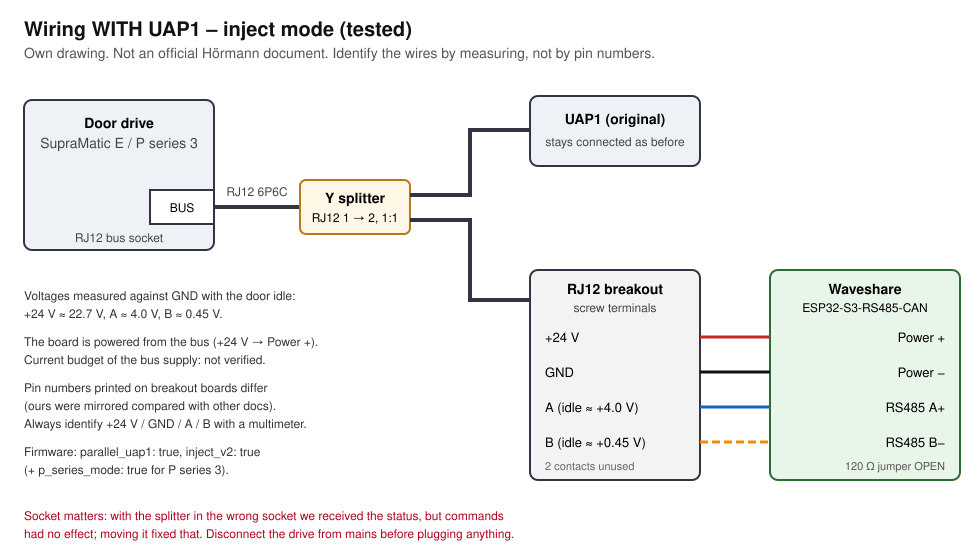
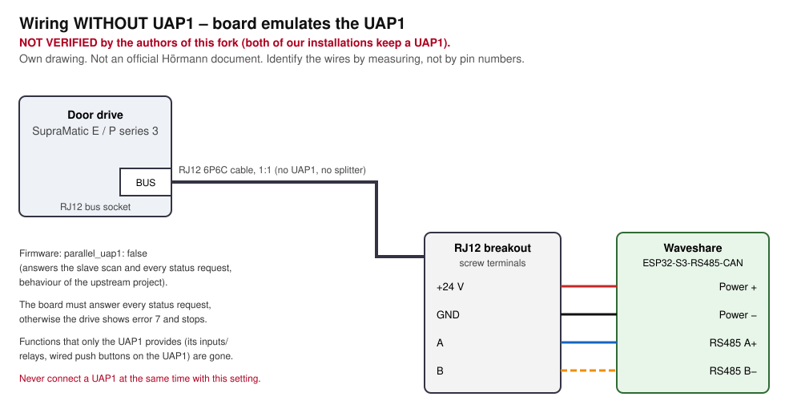

# Hörmann SupraMatic series 3 – ESPHome bus bridge (with or without UAP1)

[English](#english) · [Deutsch](#deutsch)

> **Not affiliated with Hörmann.** This is an independent community project. "Hörmann", "SupraMatic" and "UAP1"
> are trademarks of their respective owners and are used here only to describe compatibility.
> No Hörmann code, firmware, documents or schematics are included. The bus behaviour described here comes from
> our own observations and from the open-source projects listed in [NOTICE](NOTICE).

> **Safety / liability:** Use at your own risk. No warranty of any kind (see [LICENSE](LICENSE)). Opening or
> modifying the drive may affect its warranty. A moving garage door can seriously injure people and damage
> property. Never bypass or disable safety features (light barrier, force limitation, emergency release).
> Only operate the door when you can see it or when its surroundings are known to be clear. Disconnect the drive
> from mains before plugging anything into it.

---

## English

### What this is

An [ESPHome](https://esphome.io) external component that connects an ESP32 with an RS485 transceiver to the
bus of Hörmann **SupraMatic series 3** garage door drives and exposes the door in Home Assistant
(cover, light, venting position, status, error, diagnostics).

It is a fork of the `uapbridge` / `uapbridge_esp` components from
[mariopenzendorfer/esphome-hoermann_supramatic_3](https://github.com/mariopenzendorfer/esphome-hoermann_supramatic_3)
(MIT; lineage in [NOTICE](NOTICE)). This fork adds:

| Option | What it does |
|---|---|
| `parallel_uap1` (default `true`) | **Inject mode**: the original UAP1 stays connected. The board stays silent and only answers *one* status request of the drive when a command is pending. With `false` the board emulates the UAP1 (upstream behaviour). |
| `inject_v2` | Answers immediately (every received byte is evaluated, main loop runs without its 16 ms pause while a command is pending) so the board answers before the real UAP1. A command that is not fetched within **3 s** is dropped instead of blocking all further commands until reboot. Effect check against the status broadcast, max. 3 attempts only where the effect is measurable. Stop is allowed everywhere except in the end positions. |
| `p_series_mode` | For **SupraMatic P series 3**: their status only reports end positions (see below). The effect check then uses "end position left / reached"; light is sent exactly once; venting = closed position left + 25 s without end position. |
| `last_command` | Text sensor: result of the last command (sent / confirmed / unconfirmed / not fetched / rejected, attempts, fetch time). |
| `raw_status` | Text sensor: raw 16-bit status word of the broadcast, published on change. |
| `derived_status` | Text sensor: Open / Closed / Opening / Closing / Stopped / Venting / … derived from end positions and the last command – useful for drives without moving bits. |

The example also sets `restore_mode: ALWAYS_OFF` for the light so that no "toggle light" command is sent on boot.

### Tested hardware

| Drive | Article no. (type plate) | Status bits seen on the bus | Tested setup |
|---|---|---|---|
| SupraMatic **E** series 3 | 4512101 | all: open, closed, option relay, light, error, direction, moving, venting | inject mode next to UAP1 (`parallel_uap1: true`, original inject logic) |
| SupraMatic **P** series 3 | 4512200 | only `0x0002` closed, `0x0001` open, `0x0000` everything else (no moving, direction or light bits) | inject mode next to UAP1 with `inject_v2: true`, `p_series_mode: true` |

Board: Waveshare **ESP32-S3-RS485-CAN** (RS485 TX GPIO17, RX GPIO18, direction GPIO21), framework ESP-IDF.
Both setups were tested at the door: light on/off, venting, open, close, open → stop, close from intermediate
position, wireless remote and wall button in parallel.

**Not verified by us:** operation **without** UAP1 (`parallel_uap1: false`). This is the behaviour of the
upstream project; we did not test it on our drives. SupraMatic **series 4** drives use a different bus and are
**not supported**.

Status broadcast bits as observed (low byte): bit0 open · bit1 closed · bit2 option relay · bit3 light ·
bit4 error · bit5 direction close · bit6 moving · bit7 venting. Command bytes the UAP1 answers with:
`0x01` open, `0x02` close, `0x04` impulse, `0x08` toggle light, `0x10` venting (stop = `0x10FF` word, from upstream).

### Limitations

- P series 3: during travel the drive reports `0x0000`, so the upstream status shows "Gestoppt" while moving;
  use `derived_status`. The light state is not reported – Home Assistant only *assumes* it.
- With a UAP1 connected, the UAP1 and the board answer the same address. `inject_v2` relies on answering faster
  than the UAP1. Do **not** enable `DEBUG`/`VERBOSE` logging or fast template sensors – both disturbed the timing
  in our tests (commands without effect).
- Impulse (sequential control) exists as an upstream button but was not used/tested by us. Half-open, holiday
  mode and pedestrian door are not offered by the component.
- State strings of the upstream `Status` sensor are German (`Offen`, `Geschlossen`, `Öffnen`, …); the new
  diagnostic sensors are English.

### Wiring with UAP1 (inject mode, tested)



1. Disconnect the drive from mains.
2. Unplug the UAP1 bus cable, plug a **6P6C Y splitter** into that socket, connect the UAP1 cable to one output
   and the breakout cable to the other output.
3. On the breakout, identify the wires **by measuring** against GND with the door idle:
   `+24 V` ≈ 22–24 V, `A` ≈ +4 V, `B` ≈ +0.5 V. Two contacts are unused.
   The printed terminal numbers of our breakout were *mirrored* compared with other documentation – don't trust numbers.
4. Connect `+24 V` → `Power +`, `GND` → `Power −`, `A` → `A+`, `B` → `B−`. Leave the 120 Ω termination jumper **open**.
5. Firmware: [`examples/with-uap1.yaml`](examples/with-uap1.yaml); for P series 3 add `p_series_mode: true`.

Important: **the socket matters.** In our first P-series installation the splitter sat in the wrong socket: the
status was received, but no command had any effect. After moving it, everything worked.

### Wiring without UAP1 (not verified)



Same as above, but the breakout is connected with a plain 6P6C cable directly to the drive's bus socket, and the
firmware uses `parallel_uap1: false` ([`examples/without-uap1.yaml`](examples/without-uap1.yaml)). The board must
then answer every status request, otherwise the drive reports error 7 and stops. Never connect a UAP1 at the
same time with this setting. Functions that the UAP1 itself provides (its inputs/relays) are lost.

### Bill of materials (connectors stated explicitly)

| Qty | Part | Connectors / cable ends |
|---|---|---|
| 1 | Waveshare ESP32-S3-RS485-CAN | screw terminals `Power +/−` (7–36 V DC), `A+/B−`; USB-C for the first flash |
| 1 | RJ12 **6P6C** Y splitter, 1 plug → 2 sockets, **all 6 contacts wired 1:1** (only with UAP1) | RJ12 plug / 2× RJ12 socket – *not* a 6P4C telephone splitter |
| 1 | RJ12 6P6C patch cable, straight 1:1, short (e.g. 0.5–1 m) | RJ12 plug ↔ RJ12 plug |
| 1 | RJ12 6P6C socket to screw terminal breakout | RJ12 socket ↔ 6 screw terminals |
| 4 | short stranded wires 0.25–0.5 mm² | **ferrules** on both ends (screw terminal ↔ screw terminal) |
| 1 | USB-C data cable | for flashing via USB, later OTA |

Power: the board is supplied from the drive's bus (+24 V, measured 22.7 V). The current budget of that supply is
not specified by us – alternatively use a separate 12/24 V DC supply with open ends into `Power +/−` and connect
only `GND`, `A`, `B` to the bus.

### Installation

```yaml
external_components:
  - source: github://quitkelvin/hoermann-supramatic3-esphome
    components: [uapbridge, uapbridge_esp]
```

Copy an example from [`examples/`](examples/), create your own `secrets.yaml`, flash the first time via USB,
later via OTA. No prebuilt binaries are provided on purpose (they would contain WiFi credentials and keys).

### Security

- Restrict who can open the door: e.g. a template lock with a PIN in front of the cover, Home Assistant user
  permissions, do not expose the cover to voice assistants/HomeKit without a PIN.
- Use API encryption and an OTA password (see example), keep `secrets.yaml` out of version control.
- `auto_correction: false` (recommended) prevents the board from sending commands on its own.

### Troubleshooting

| Symptom | Likely cause |
|---|---|
| `Drive connected` stays off, no status | A/B swapped, wrong socket, wrong pins, 120 Ω jumper closed, wrong UART pins |
| Status OK, commands without effect (with UAP1) | wrong socket of the splitter; `inject_v2` not enabled; DEBUG logging or fast template sensors disturbing the timing |
| First command works, later ones are "rejected" | old inject logic without fetch timeout – enable `inject_v2` |
| Error 7 on the drive | without UAP1: board does not answer (check `parallel_uap1: false`, wiring); with UAP1: never set `parallel_uap1: false` |
| Shows "Gestoppt" while moving | P series 3 – use `derived_status` and `p_series_mode` |
| OTA fails / high latency | WiFi power saving – `power_save_mode: none` |

---

## Deutsch

### Was ist das?

Eine externe [ESPHome](https://esphome.io)-Komponente, die einen ESP32 mit RS485-Baustein an den Bus von
Hörmann-Garagentorantrieben der **SupraMatic Serie 3** anbindet und das Tor in Home Assistant bereitstellt
(Tor, Licht, Lüftungsstellung, Status, Fehler, Diagnose).

Abgeleitet von `uapbridge`/`uapbridge_esp` aus
[mariopenzendorfer/esphome-hoermann_supramatic_3](https://github.com/mariopenzendorfer/esphome-hoermann_supramatic_3)
(MIT, Herkunft siehe [NOTICE](NOTICE)). Neu in diesem Fork:

- `parallel_uap1` (Standard `true`): **Einwurf-Modus** – die echte UAP1 bleibt dran, das Board schweigt und
  beantwortet nur bei einem offenen Befehl genau eine Statusabfrage. `false` = Board ersetzt die UAP1 (Upstream-Verhalten).
- `inject_v2`: sofortige Antwort (jedes Byte wird ausgewertet, Hauptschleife ohne 16-ms-Pause, solange ein Befehl
  offen ist), **3-s-Abhol-Timeout** statt Dauersperre, Wirkungsprüfung am Status, Wiederholung nur wo messbar,
  Stopp überall außer in den Endlagen.
- `p_series_mode`: für die **SupraMatic P Serie 3**, die nur Endlagen meldet – Wirkung über „Endlage verlassen/erreicht“,
  Licht genau einmal senden, Lüftung = Zu verlassen + 25 s ohne Endlage.
- Sensoren `last_command` („Letzter Befehl“), `raw_status` („Rohstatus“), `derived_status` („Status abgeleitet“).
- Beispiel mit `restore_mode: ALWAYS_OFF` fürs Licht (beim Start wird nichts gesendet).

### Getestet

- SupraMatic **E** Serie 3 (Art.-Nr. 4512101): alle Statusbits; Einwurf-Modus neben UAP1.
- SupraMatic **P** Serie 3 (Art.-Nr. 4512200): nur `0x0002` zu, `0x0001` auf, `0x0000` sonst (keine Fahrt-,
  Richtungs- oder Licht-Bits); Einwurf-Modus neben UAP1 mit `inject_v2` + `p_series_mode`.
- Board Waveshare ESP32-S3-RS485-CAN (TX GPIO17, RX GPIO18, Richtung GPIO21), ESP-IDF.
- **Nicht von uns geprüft:** Betrieb **ohne** UAP1. Serie 4 wird **nicht** unterstützt.

### Verkabelung mit UAP1 (getestet)

Siehe Zeichnung oben. Antrieb stromlos machen, **Y-Stecker 6P6C** (alle 6 Kontakte 1:1, kein 6P4C-Telefonverteiler)
in die Buchse stecken, aus der das UAP1-Kabel kam; ein Ausgang zur UAP1, einer über ein 6P6C-Kabel zum
RJ12-Klemmenadapter. Adern **durch Messen** bestimmen (gegen GND, Tor in Ruhe): +24 V ≈ 22–24 V, A ≈ +4 V,
B ≈ +0,5 V; zwei Kontakte frei. Die aufgedruckten Klemmennummern unseres Adapters waren gegenüber anderer Doku
gespiegelt. +24 V → Power +, GND → Power −, A → A+, B → B−, 120-Ω-Jumper **offen**.
**Die Buchse ist entscheidend:** Bei uns steckte der Y-Stecker zuerst falsch – Status kam an, Befehle wirkten nicht.

### Verkabelung ohne UAP1 (nicht geprüft)

Klemmenadapter mit einem 6P6C-Kabel direkt an die Bus-Buchse, Firmware mit `parallel_uap1: false`. Das Board muss
jede Statusabfrage beantworten, sonst Fehler 7. Nie gleichzeitig eine UAP1 anstecken.

### Stückliste

Waveshare ESP32-S3-RS485-CAN (Schraubklemmen Power +/− 7–36 V, A+/B−, USB-C) · RJ12-Y-Stecker 6P6C 1 Stecker → 2
Buchsen, alle 6 Kontakte 1:1 (nur mit UAP1) · RJ12-Patchkabel 6P6C 1:1, Stecker ↔ Stecker · RJ12-Buchse auf
6 Schraubklemmen · 4 Litzen 0,25–0,5 mm² mit **Aderendhülsen** an beiden Enden · USB-C-Datenkabel zum ersten Flashen.
Versorgung bei uns aus dem Bus (+24 V, gemessen 22,7 V); Belastbarkeit nicht geprüft – alternativ eigenes 12/24-V-Netzteil.

### Sicherheit und Haftung

Nutzung auf eigene Gefahr, keine Gewähr. Eingriffe können die Garantie des Antriebs berühren. Torbewegungen sind
gefährlich; Sicherheitseinrichtungen (Lichtschranke, Kraftbegrenzung, Notentriegelung) nie umgehen. Tor nur
fahren, wenn der Bereich frei ist. Zugriff absichern: PIN-Schloss vor dem Tor in Home Assistant, Benutzerrechte,
keine Freigabe an Sprachassistenten ohne PIN, API-Verschlüsselung und OTA-Passwort.

### Fehlersuche

Siehe Tabelle im englischen Teil: kein Status → A/B, Buchse, Pins, Jumper prüfen; Status ja, Befehle nein →
Buchse des Y-Steckers, `inject_v2`, kein DEBUG-Logging; Fehler 7 → ohne UAP1 antwortet das Board nicht bzw. mit
UAP1 nie `parallel_uap1: false`; „Gestoppt“ während der Fahrt → P-Serie, `derived_status` nutzen.

## License

MIT – see [LICENSE](LICENSE) and [NOTICE](NOTICE).
